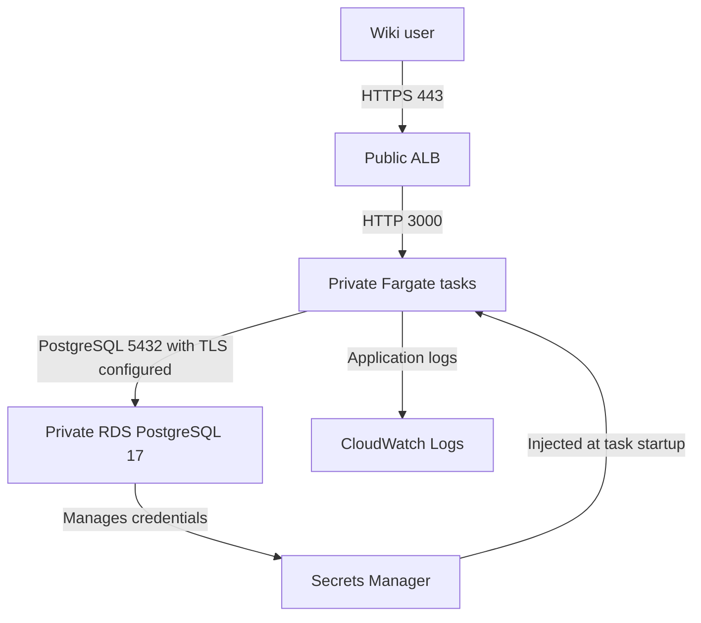

# Wiki.js on AWS with Terraform

I built this project to run Wiki.js on private ECS Fargate tasks behind an HTTPS load balancer, with PostgreSQL on RDS. It began as a technical hiring assessment. Later changes introduced RDS-managed credentials, reproducible image references, and an event-driven request to replace tasks after password rotation.

## Architecture



The VPC has public and private subnets in two AZs. One NAT Gateway provides outbound access, including Docker Hub pulls. Secrets Manager and CloudWatch Logs interface endpoints use private DNS in both private subnets. TLS terminates at the ALB. ALB-to-task traffic uses HTTP inside the VPC.

The application image is `requarks/wiki:2.5.317`, pinned by its published OCI index digest. The index includes Linux AMD64 and ARM64 images; the task definition explicitly selects Linux X86_64. Updating the pin requires release review and runtime testing. A version update alone does not demonstrate remediation of every published advisory.

## Repository layout

- Root Terraform files compose the modules and define the S3 backend and rotation workflow.
- `modules/` contains VPC, security groups, ALB, ECS, IAM, and RDS definitions.
- `bootstrap/state-backend/` is a separate Terraform root for the state bucket.
- `tests/` and `bootstrap/state-backend/tests/` contain AWS provider mock tests.
- `.github/workflows/terraform-ci.yml` validates configuration and scans source history and IaC.

## Validation without AWS resources

Use Terraform 1.14.6 or later within major version 1. CI uses 1.14.6. Provider selections are committed in a lockfile for each root.

```bash
terraform init -backend=false -input=false -lockfile=readonly
terraform fmt -check -recursive
terraform validate
terraform test

terraform -chdir=bootstrap/state-backend init -backend=false -input=false -lockfile=readonly
terraform -chdir=bootstrap/state-backend validate
terraform -chdir=bootstrap/state-backend test
```

The tests use a mocked AWS provider and plan-only runs. They check restricted initial access, private tasks, secret references, database encryption and TLS enforcement, HTTPS routing, application health configuration, and state-bucket public access protection. They require provider downloads but no AWS credentials or resources. They do not exercise AWS APIs, IAM authorization, event delivery, or the application.

CI also runs Trivy configuration scanning for HIGH/CRITICAL findings and Gitleaks on Git history. Actions are pinned to commit SHAs and the Trivy container to a digest. The pipeline does not deploy infrastructure. Inspect the [Actions runs](https://github.com/shimon066536/wikijs-infra/actions) for results on the commit being reviewed.

## Initial deployment and application setup

Required root inputs are `region`, `app_domain_name`, `acm_certificate_arn`, and `allowed_client_cidrs`. Defaults exist for `name` and `db_username`.

1. Supply an issued ACM certificate in the ALB region and a domain covered by that certificate. DNS and certificate issuance are managed outside this repository.
2. Set `allowed_client_cidrs` to the operator's public IPv4 address with `/32`. This input intentionally has no default. A fresh Wiki.js database exposes an installation wizard that creates the first administrator.
3. Initialize the backend, review an authenticated plan, and deploy only after checking cost and cleanup requirements. Use `alb_dns_name` to configure the DNS record.
4. Complete setup through HTTPS while access is restricted. Confirm administrator login, guest permissions, database connectivity, and `/healthz` behavior.
5. Broaden `allowed_client_cidrs` deliberately after setup. Public access uses `["0.0.0.0/0"]`.

The ALB checks `/healthz` with status 200. During initial setup, Wiki.js may serve the wizard on this path, so ALB health alone cannot establish setup completion. After setup, check the JSON response and an actual page read. The ECS service allows 120 seconds for startup and enables deployment rollback; this grace period is an initial setting requiring runtime measurement.

## State management

The root declares an S3 backend with encryption and native lockfiles. Before backend initialization, provision the bucket using `bootstrap/state-backend/`. Its configuration enables versioning, SSE-S3 encryption, and all four public-access blocks.

Preserve the bootstrap root's own local state. Copy `backend.hcl.example` to ignored `backend.hcl`, supply the real bucket and region, and run `terraform init -backend-config=backend.hcl`. Back up existing state before a migration. Backend credentials need access to the state object and the `.tflock` object, including permission to delete the lockfile. Backend initialization, concurrent locking, and recovery need AWS verification.

Keep credentials, state, plan files, and local variable files outside Git. The configuration passes the RDS secret ARN into the task definition; ECS resolves its `username` and `password` fields at startup.

## Engineering decisions and trade-offs

- **Managed credentials.** RDS owns the master password and its Secrets Manager secret. Terraform does not generate or retrieve the password. The application currently uses the database master account. A dedicated database user should be tested through installation and migrations before changing this model.
- **Rotation recovery.** A native Secrets Manager `Secret Label Updated` event matches the exact secret ARN and `AWSCURRENT`. EventBridge starts a Standard Step Functions workflow, waits 30 seconds, and requests `ecs:UpdateService` with `ForceNewDeployment`. IAM policies scope each action to its target. Execution success means the API request succeeded. Confirm new task health and a database operation separately. Existing pooled connections can mask an outdated password.
- **Limited availability.** One desired task, single-AZ RDS, and one NAT Gateway keep the lab smaller. A rolling ECS deployment may temporarily run additional tasks. This topology has interruption risks, including cross-AZ dependency on the NAT. Rollback cannot restore a rotated database password.
- **Private service access.** Two interface endpoints across two AZs add four endpoint-AZ hourly charges alongside the NAT. They provide private paths to logs and secrets. Removing them is a possible lab cost reduction after reviewing routing requirements.
- **Disposable database.** The configuration skips a final snapshot on deletion. Treat lab data as disposable until backup retention, deletion protection, and restore procedures have been chosen and tested.

ALB, Fargate, RDS, NAT, public IPv4, interface endpoints, Secrets Manager, logging, and workflow usage can incur charges. Static and mock validation does not provision them. A stopped application does not remove networking and storage charges.

## Security considerations

The database is private and encrypted, database ingress is limited to the task security group, and RDS requires SSL. Wiki.js sets `DB_SSL=true`, which enables certificate verification in the selected application version. Trust of the RDS certificate chain has not been established by runtime testing. Supply and test an appropriate trusted CA before relying on this connection; do not disable certificate verification to make it connect.

Three resource-scoped Trivy exceptions remain documented in source: public ALB exposure (`AWS-0053`), outbound IPv4 HTTPS from tasks for public registries and APIs (`AWS-0104`), and SSE-S3 for the state bucket (`AWS-0132`). Review application advisories separately from IaC findings. The image pin provides reproducibility; the current CI does not scan application dependencies inside that image.

## Remaining verification

An AWS deployment has not been verified as part of this work. The highest-value next checks are:

1. Run the pinned Wiki.js image against PostgreSQL 17 locally. Test initial setup, guest authorization, persistent page storage, `/healthz`, and TLS with both trusted and untrusted CAs.
2. Change the local database password, force a new connection, then recreate the application with the new credential. Verify recovery and retained data.
3. In a temporary AWS deployment, verify backend locking, DNS/ACM, task startup, RDS certificate trust, and a real managed-secret rotation. Observe the event, workflow, replacement task, target health, and page read separately.

See [Issue #1](https://github.com/shimon066536/wikijs-infra/issues/1) for the original hardening and verification work.
